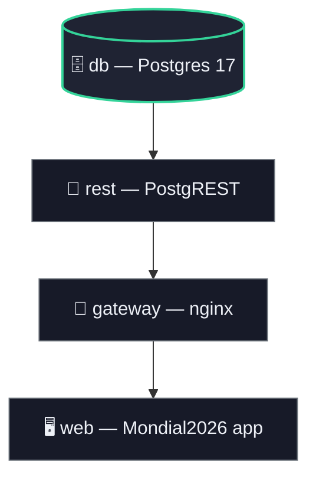
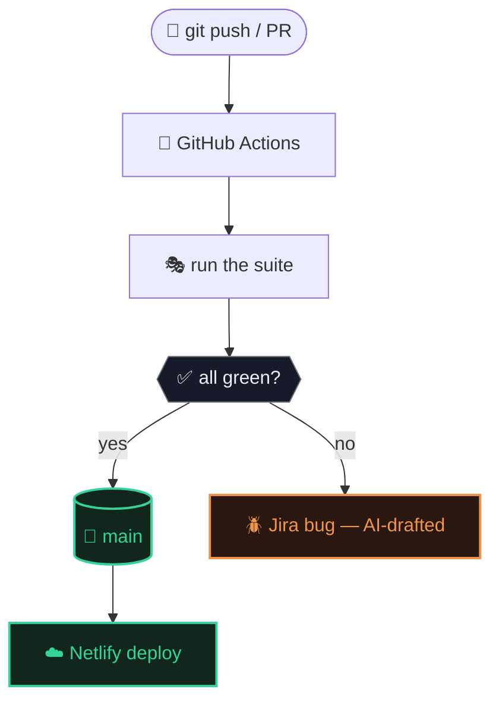

# 🚀 AI-Assisted QA Automation — Mundial2026

## 📖 Project Overview

A portfolio project demonstrating end-to-end QA automation: testing [Mundial2026](https://pgmondial2026.netlify.app)
(a World Cup 2026 score-prediction app) entirely from the outside — UI, API, SQL, load, and
production monitoring, gated by CI/CD so broken code can never reach `main`.

This repo holds the test environment and test suites. The app under test lives in its own repo
(`../Mondial2026`) and is never modified here. The pipeline found **3 real production bugs**.

**[Presentation deck](https://claude.ai/artifact/C9odmz8w36PEMC5rHogL8B)** &middot;
**[Full setup guide](https://claude.ai/artifact/HwGUnJ2riepNMhRY8PgrQe)**

## 🛠 Tools & Technologies

- **Automation**: Playwright 🎭 + TypeScript ⚡
- **Backend under test**: Postgres 17 + PostgREST 🗄️, proxied through nginx
- **Containerization**: Docker Compose 🐳 — no Supabase CLI install needed
- **Load testing**: k6 📈
- **CI/CD**: GitHub Actions 🚀, branch-protected on `main`
- **Bug tracking**: Jira 🪲 — AI-assisted triage, human-approved before filing
- **AI assistant**: Claude Code 🤖

## 🏗 Architecture

| Service | Image | Role |
|---|---|---|
| `db` | `postgres:17-alpine` + `pg-safeupdate` | Schema + seed run automatically on first start |
| `rest` | `postgrest/postgrest` | Turns the schema into a REST API |
| `gateway` | `nginx:alpine` | Adds the `/rest/v1` prefix `supabase-js` expects |
| `web` | built from `docker/Dockerfile.app` | The Mondial2026 app, served statically |
| `tests` | `mcr.microsoft.com/playwright` | Runs `tests/ui`, `tests/api`, `tests/sql` |
| `load` | `grafana/k6` | Optional load test, informational only |
| `db-editor` | `adminer` | Optional DB GUI |


`tests` drives `web` and calls `rest`/`db` directly. One command brings it all up: `npm run env:up`
(always rebuilds `web`, so you never test stale code against fresh test runs). The `db` volume
persists across restarts — `clean-test-users.mjs` wipes non-seed signups after every `env:up`.


Branch protection on `main` requires the `test` check to pass — Netlify deploys `main` with no idea
CI exists, so the gate has to happen before the merge, not after.

**Known limitation**: `restart: unless-stopped` is set on every service, but on this machine's
Docker Engine (WSL2, not Docker Desktop) a killed container doesn't actually restart itself — tested
directly. `npm run status` is the reliable check, not the restart policy.

## 🏆 Key Features

✔️ One-command Docker Compose environment — no Supabase CLI, no manual secrets
✔️ UI + API + SQL coverage against a real, disposable backend
✔️ Required vs. informational signals (load tests never block a merge)
✔️ Branch-protected CI/CD across two repos
✔️ AI-assisted bug triage straight into Jira, human-approved before filing
✔️ Production smoke test every 6 hours
✔️ Zero-setup installers for Windows + Mac
✔️ `npm run status` — verifies the stack is actually serving, not just "running"

## 🧪 Test Coverage

- **🔐 UI** (`tests/ui`) — sign-up, admin login bypass, logout, session persistence, phone
  validation (empty / too long / too short / non-numeric), nav & icon checks
- **🔌 API** (`tests/api`) — users, matches, predictions: CRUD, unique/not-null/foreign-key/check
  violations, cascade delete, unfiltered writes blocked
- **🗄️ SQL** (`tests/sql`) — leaderboard correctness, grouping by outcome, ranking, uniqueness
- **📈 Load** (`k6`) — ~20 concurrent users signing up, fetching matches, predicting; informational
- **🌐 Production smoke** (`tests/smoke`) — read-only check against the live app, every 6h

## 🚀 Running It

**Zero setup** — double-click `install.bat` (Windows) / `install.command` (Mac): installs
everything, clones both repos, brings the stack up, opens the app.

**Manual**:
```bash
git clone https://github.com/PashaGend/mundial-qa-automation.git
cd mundial-qa-automation
npm run setup
```
Opens `http://localhost:8080` (ports: `web` 8080, `gateway` 8000, `rest` 3000, `db` 55432).

**Run the tests**:
```bash
docker compose --env-file .env.docker run --rm tests
```
**Run the load test**: `docker compose --env-file .env.docker run --rm load`
**DB GUI**: `docker compose --env-file .env.docker up -d db-editor` → `localhost:8081`

**Check it's up**: `npm run status` &middot; **Reset**: `docker compose down -v --remove-orphans`
&middot; **Uninstall**: `uninstall.bat` / `uninstall.command`

Needs Docker Desktop + Node.js, nothing else. Every command, explained: **[Full setup guide](https://claude.ai/artifact/HwGUnJ2riepNMhRY8PgrQe)**.

## 🔄 CI/CD

- `playwright.yml` — full suite on every push/PR, both repos
- `load.yml` — daily k6 run, informational only, doesn't gate merges
- `smoke.yml` — production uptime check every 6h
- Branch protection on `main`: PR required, `test` check required — pushing straight to `main` is
  rejected, and a red check blocks the merge button outright

**Shipping a change**:
```bash
git checkout -b my-change
git add -A && git commit -m "..." && git push -u origin my-change
```
Open a PR; once `test` is green, the **Merge** button unlocks — merging is what triggers Netlify's deploy.

## 🤖 AI-Assisted Bug Filing

On a test failure, Claude Code drafts the report; a human approves it; then:
```bash
node scripts/file-jira-bug.mjs "<title>" "<description>"
```
Files directly to Jira (project `KAN`). Credentials live in `.env` (gitignored). Deliberately
manual, not wired into CI — keeps a human in the loop and avoids spamming the board from flaky runs.
